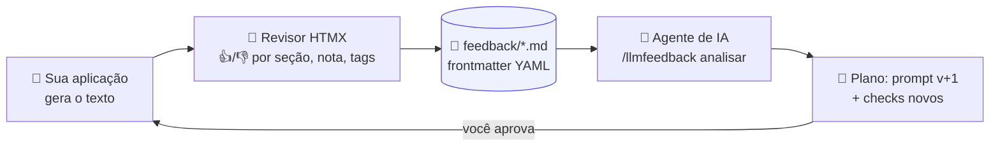
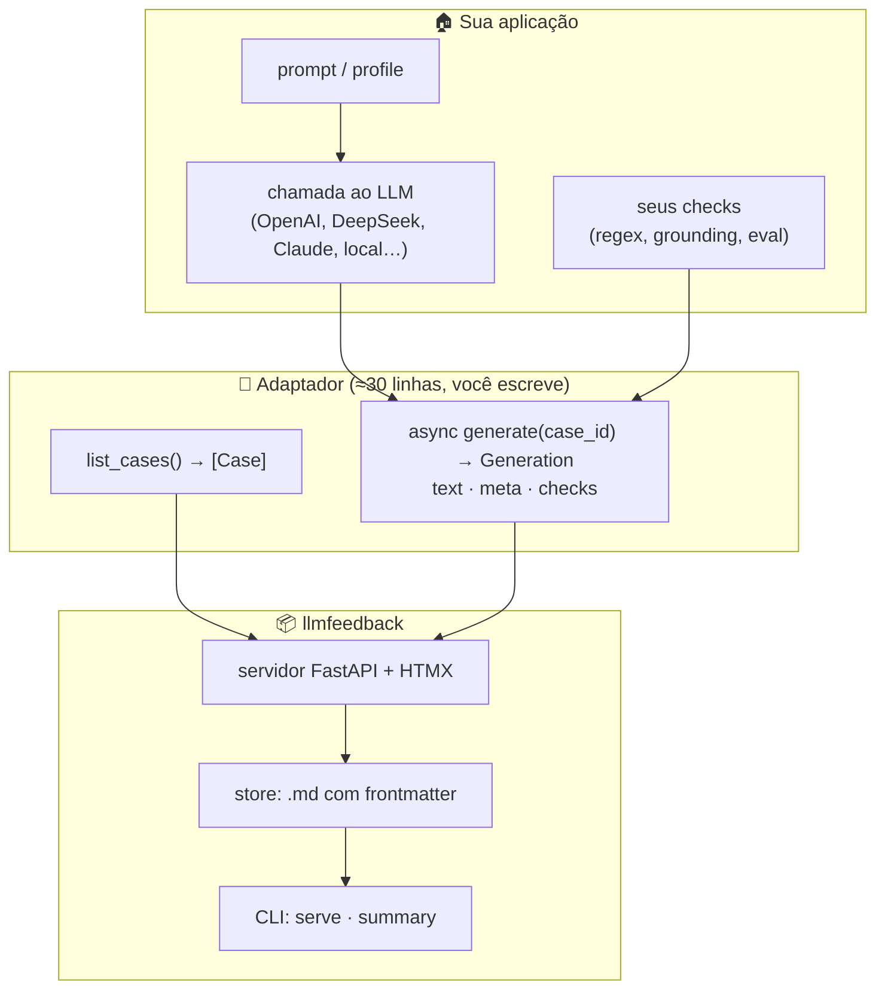
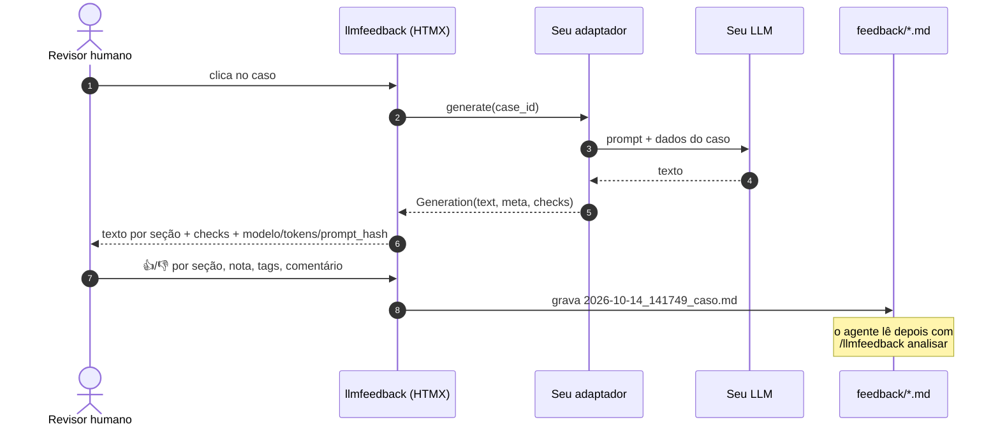
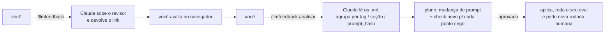

<div align="center">

# 🧑‍⚖️ llmfeedback

**Revisão humana para saídas de LLM, com o feedback salvo em Markdown e lido por um agente de IA.**

Gere → vote seção a seção → salve em `.md` → deixe o Claude (ou outro agente) ler, agrupar e propor a correção do prompt.

`FastAPI` · `HTMX` · `Markdown + YAML` · `zero banco de dados`

</div>

---

## Por que existe

Checks automáticos (regex, grounding, gates de eval) pegam o que você **já sabe** que pode dar errado.
O humano pega o resto: o tom, o jargão, a frase que está tecnicamente certa mas o cliente não entende.

O llmfeedback fecha esse ciclo:



Cada problema que o humano aponta e os checks não pegaram vira um **check automático novo**. Com o tempo, o gate cobra sozinho o que antes só uma pessoa via.

---

## Como conectar com a sua aplicação

O llmfeedback **não conhece** o seu modelo, o seu prompt nem os seus dados. Ele conversa com a sua aplicação por um **adaptador**: um objeto Python com dois métodos.



### O fluxo de uma revisão



---

## Em 3 passos

### 1. Instale

```bash
pip install git+https://github.com/<seu-usuario>/llmfeedback
```

### 2. Escreva o adaptador

```python
# meu_projeto/review_adapter.py
from llmfeedback import Case, Generation
from llmfeedback.checks import must_not_contain

from meu_projeto.llm import gerar_resumo, PROMPT_VERSION   # o seu código


class MeuAdapter:
    name = "meu-projeto"
    tags = ["fato errado", "jargão técnico", "tom inadequado"]   # opcional

    def list_cases(self):
        return [Case(id="pedido-atrasado", description="explicar atraso ao cliente")]

    async def generate(self, case_id):
        resp = await gerar_resumo(case_id)                      # chama o SEU LLM
        return Generation(
            text=resp.text,                                     # Markdown com ## seções
            meta={"model": resp.model, "prompt_hash": PROMPT_VERSION,
                  "total_tokens": resp.tokens, "latency_ms": resp.ms},
            checks=must_not_contain(resp.text, [r"[—–]"]),      # seus checks
        )

    def display(self, text):                                   # opcional
        return text   # mostre como o usuário final vê (pós-processamento)
```

> 💡 O `prompt_hash` é o que permite ao agente comparar **nota média por versão de prompt**: "a v3 melhorou ou piorou?".

### 3. Suba o revisor

```bash
llmfeedback serve --adapter meu_projeto.review_adapter:MeuAdapter --dir feedback
# → http://127.0.0.1:7930
```

Sem LLM à mão? Teste com o adaptador de exemplo:

```bash
llmfeedback serve --adapter examples.static_adapter:StaticAdapter
```

---

## O contrato do adaptador

| Membro | Obrigatório | O que faz |
|---|:---:|---|
| `name: str` | ✅ | Gravado em cada feedback (`adapter:`) |
| `list_cases() -> list[Case]` | ✅ | O que aparece na lista à esquerda |
| `async generate(case_id) -> Generation` | ✅ | Gera o texto: chama o seu LLM do jeito que a sua aplicação já chama |
| `tags: list[str]` | — | Troca as tags padrão |
| `display(text) -> str` | — | Transforma o texto só na tela (o `.md` guarda o texto cru) |

`Generation.meta` é livre, mas a tela destaca `model`, `prompt_hash`, `total_tokens` e `latency_ms`.

Helpers prontos em `llmfeedback.checks`: `must_contain`, `must_not_contain`, `required_sections`.

---

## O feedback é o banco

Um arquivo por avaliação, legível, versionável no git e fácil de um agente ler:

```markdown
---
case: pedido-atrasado
rating: 3
tags: [jargão técnico]
sections:
- {title: Resumo, vote: up, comment: ''}
- {title: Próximos passos, vote: down, comment: 'cita SLA, cliente não sabe o que é'}
adapter: meu-projeto
meta: {model: deepseek-v4-flash, prompt_hash: 92838cb2afe583f9, total_tokens: 812}
auto_checks: {passed: true, failed: []}
verdict: reprovado
---

# Feedback 2026-10-14_141749_pedido-atrasado

## Comentário geral
explique como se fosse para uma pessoa leiga!

## Texto avaliado
## Resumo
...
```

`verdict` é **reprovado** quando a nota é ≤ 2 ou alguma seção levou 👎.

```bash
llmfeedback summary --dir feedback
# 12 feedbacks · por prompt_hash: v2 nota 3.4 (58% reprovado) → v3 nota 4.6 (8%)
# reprovados pelo humano com checks automáticos verdes: 4   ← pontos cegos
```

---

## Ligando no Claude Code

Copie `claude/commands/llmfeedback.md` para `.claude/commands/` no seu projeto e ajuste `ADAPTER`, `DIR` e `PORT`.



Funciona com qualquer agente que leia arquivos: o formato é só Markdown.

---

## Segurança

- O revisor **não tem login**. O padrão é `127.0.0.1`. Para acesso remoto use túnel SSH:
  `ssh -L 7930:localhost:7930 usuario@servidor`.
- Cada clique em "gerar" chama o seu LLM (custa dinheiro). Não exponha publicamente.
- O texto do LLM é **escapado** antes de virar HTML; comentários do revisor também.
- Use casos **anonimizados** se os `.md` forem para o git.

---

## Desenvolvimento

```bash
python -m venv .venv && . .venv/bin/activate
pip install -e ".[dev]"
pytest
```

Licença [MIT](LICENSE).
