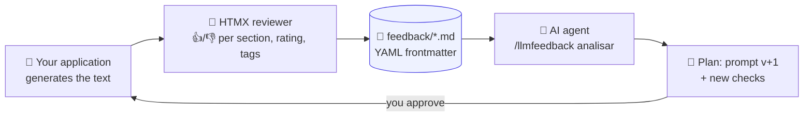
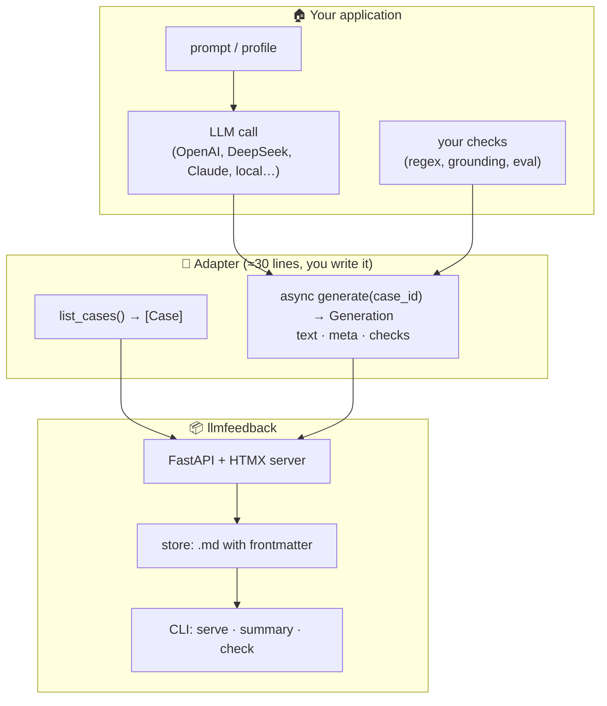
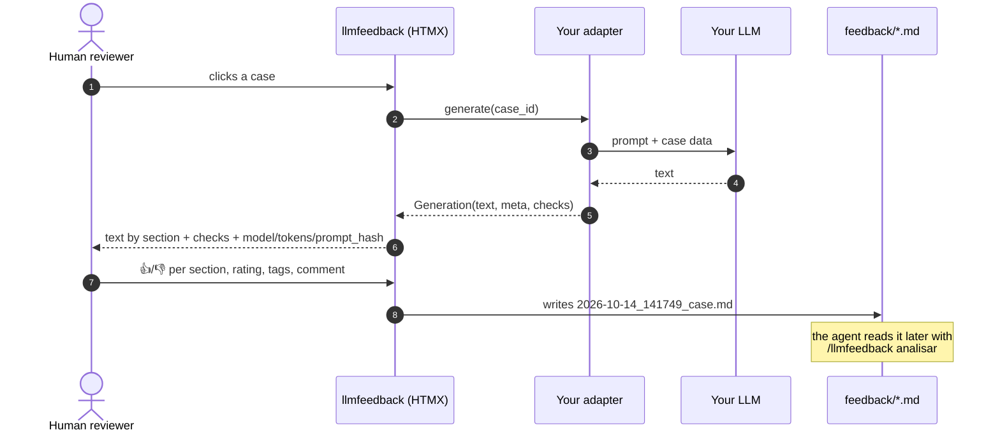
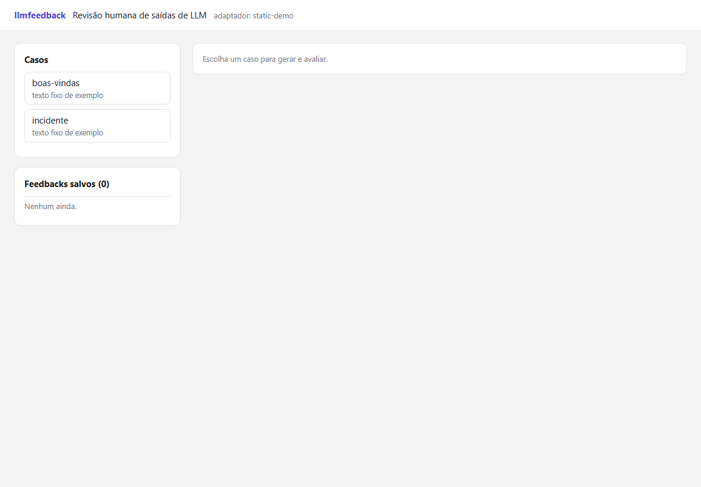
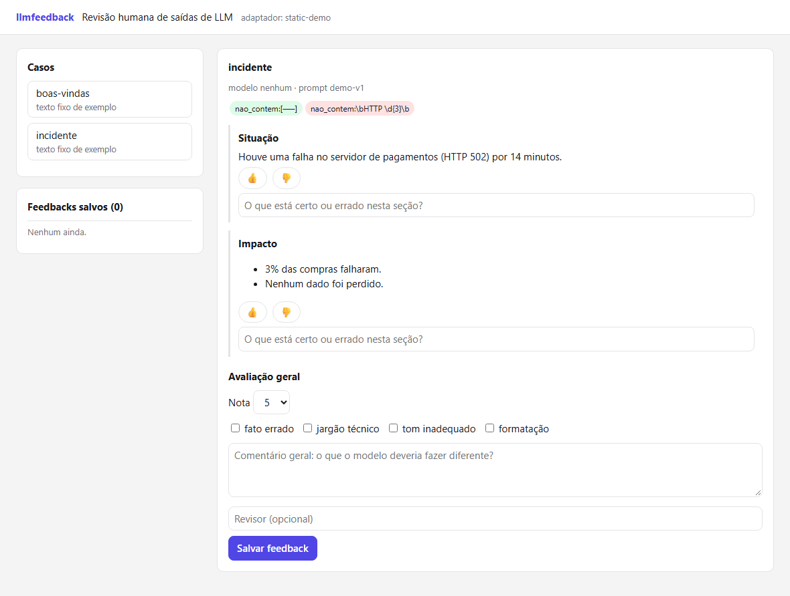
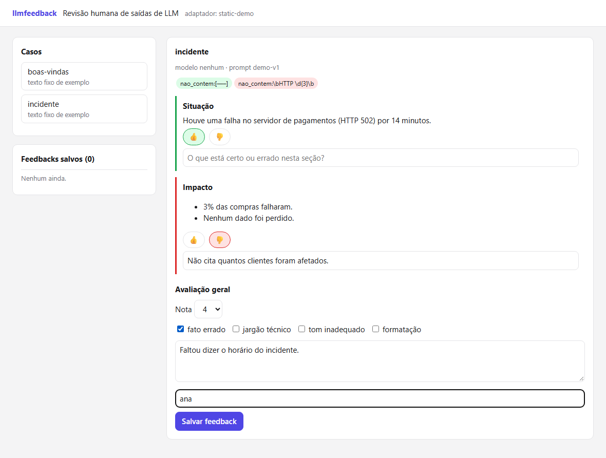
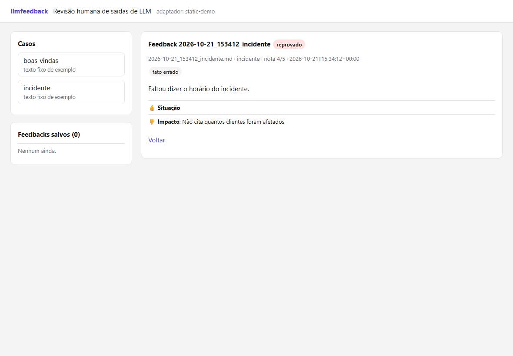
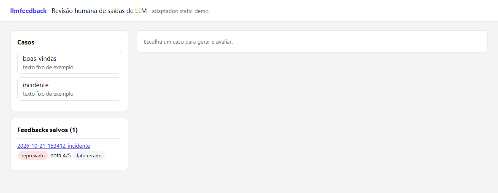
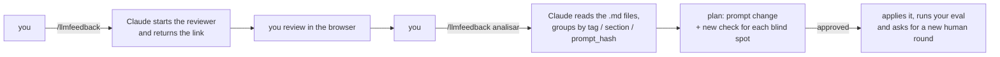

<div align="center">

# 🧑‍⚖️ llmfeedback

**Human review for LLM outputs, with the feedback saved as Markdown and read by an AI agent.**

Generate → vote section by section → save to `.md` → let Claude (or another agent) read it, group it and propose the prompt fix.

`FastAPI` · `HTMX` · `Markdown + YAML` · `zero database`

</div>

---

## Why it exists

Automated checks (regex, grounding, eval gates) catch what you **already know** can go wrong.
Humans catch the rest: the tone, the jargon, the sentence that is technically correct but the customer doesn't understand.

llmfeedback closes that loop:



Every problem a human points out that the checks missed becomes a **new automated check**. Over time, the gate enforces on its own what only a person used to see.

> **Note:** the reviewer UI, the `/llmfeedback analisar` command argument and the section markers inside the feedback files (`## Comentário geral`, `## Texto avaliado`) are in Portuguese. The docs are in English; the screenshots below show the UI as it is.

---

## What it does

| Feature | How | What for |
|---|---|---|
| **Per-section review** | HTMX UI: 👍/👎 per `#`–`###` section, 1–5 rating, tags, comment | Catch tone, jargon and sentences that are right but confusing |
| **On-demand generation** | `serve --adapter` calls your LLM through an adapter | Review exactly what your prompt produces today |
| **Production review** | `serve --jsonl logs.jsonl [--sample N]` | Evaluate outputs already served, without spending tokens |
| **Automated checks next to the vote** | `checks.py` and `checks.json` | Show what the machine already caught and what only the human saw |
| **Markdown feedback** | one `.md` per review, YAML frontmatter | Version it in git and let an agent read it |
| **Summary and blind spots** | `llmfeedback summary` | Rating per `prompt_hash`, tags, 👎 sections, rejected despite green checks |
| **Prompt history** | `meta["prompt"]` → `feedback/prompts/<hash>.md`; `summary` shows the diff | See what changed between v1 and v2 and how the rating reacted |
| **CI gate** | `llmfeedback check --rules checks.json --jsonl outputs.jsonl` | Enforce on its own what only a person used to see (exits 1 on failure) |
| **Agent analysis** | `/llmfeedback analisar` (Claude Code) | Group problems and propose prompt v+1 and new checks |

---

## How to connect it to your application

llmfeedback **knows nothing** about your model, your prompt or your data. It talks to your application through an **adapter**: a Python object with two methods.



### How a review flows



### The system in action

Real screenshots, taken with the example adapter (`examples.static_adapter:StaticAdapter`).

**1. Pick a case** — the list is on the left; already-saved feedbacks appear below it.



**2. Read the output section by section** — each `##` of the text becomes a votable block. The chips at the top are the automated checks (green passed, red failed) and the line right above shows the model and `prompt_hash`.



**3. Give 👍/👎 per section, a rating, tags and a comment** — here the automated check caught the `HTTP 502`, and the human rejected the *Impacto* section for a reason no rule can see.



**4. Saved** — the verdict (`reprovado`, i.e. rejected, if the rating is ≤ 2 or any section got 👎) and the created `.md` file show up immediately.



**5. The feedback is a file** — after a reload it shows up in the saved list.



---

## In 3 steps

### 1. Install

```bash
pip install git+https://github.com/<your-user>/llmfeedback
```

### 2. Write the adapter

```python
# my_project/review_adapter.py
from llmfeedback import Case, Generation
from llmfeedback.checks import must_not_contain

from my_project.llm import generate_summary, PROMPT_VERSION   # your code


class MyAdapter:
    name = "my-project"
    tags = ["wrong fact", "technical jargon", "wrong tone"]   # optional

    def list_cases(self):
        return [Case(id="late-order", description="explain the delay to the customer")]

    async def generate(self, case_id):
        resp = await generate_summary(case_id)                  # calls YOUR LLM
        return Generation(
            text=resp.text,                                     # Markdown with ## sections
            meta={"model": resp.model, "prompt_hash": PROMPT_VERSION,
                  "total_tokens": resp.tokens, "latency_ms": resp.ms},
            checks=must_not_contain(resp.text, [r"[—–]"]),      # your checks
        )

    def display(self, text):                                   # optional
        return text   # show it the way the end user sees it (post-processing)
```

> 💡 `prompt_hash` is what lets the agent compare the **average rating per prompt version**: "did v3 improve or get worse?".
>
> Want to see **what changed** too? Return the prompt text in `meta["prompt"]`. The first time a hash appears, the text is written to `feedback/prompts/<hash>.md` (once, not in every feedback; the first version written wins), and `llmfeedback summary` shows the diff between consecutive versions, in the order of each one's first feedback. Without `meta["prompt"]` everything still works, just without the diff.

> No adapter: if you already have logs, skip step 2 and use `--jsonl` (see [Reviewing production](#reviewing-production)).

### 3. Start the reviewer

```bash
llmfeedback serve --adapter my_project.review_adapter:MyAdapter --dir feedback
# → http://127.0.0.1:7930
```

No LLM at hand? Try the example adapter:

```bash
llmfeedback serve --adapter examples.static_adapter:StaticAdapter
```

---

## Reviewing production

A JSONL file with one output per line becomes the case list, with no adapter to write and no LLM call:

```jsonl
{"id": "ord-4521", "input": "Order was 3 days late", "output": "## Resumo\n...", "model": "x", "prompt_hash": "v3"}
```

Only `output` (or `text`) is required; `id`, `title`, `input`, `model`, `prompt_hash`, `prompt`, `total_tokens`, `latency_ms` (or a `meta` dict) are optional.

```bash
llmfeedback serve --jsonl logs.jsonl --sample 30 --seed 1 --rules checks.json
```

`--sample` draws N random lines (`--seed` makes the draw repeatable).

## From blind spot to CI gate

Every problem the human found and the checks missed becomes a rule in `checks.json`, versioned in git:

```json
[
  {"name": "no-em-dash", "type": "must_not_contain", "patterns": ["[—–]"]},
  {"name": "structure", "type": "required_sections", "titles": ["Resumo", "Próximos passos"]}
]
```

Types: `must_contain`, `must_not_contain` (regex in `patterns`) and `required_sections` (`titles`, in order). The same file feeds the reviewer (`--rules`) and CI:

```bash
llmfeedback check --rules checks.json --jsonl outputs.jsonl   # exit code 1 if any output fails
```

An invalid `checks.json` aborts instead of silently passing.

---

## The adapter contract

| Member | Required | What it does |
|---|:---:|---|
| `name: str` | ✅ | Written into every feedback (`adapter:`) |
| `list_cases() -> list[Case]` | ✅ | What shows up in the list on the left |
| `async generate(case_id) -> Generation` | ✅ | Generates the text: calls your LLM the same way your application already does |
| `tags: list[str]` | — | Replaces the default tags |
| `display(text) -> str` | — | Transforms the text on screen only (the `.md` keeps the raw text) |

`Generation.meta` is free-form, but the screen highlights `model`, `prompt_hash`, `total_tokens` and `latency_ms`. `prompt` (the system prompt text) is optional and goes to `feedback/prompts/`, outside the feedback `.md` files.

Ready-made helpers in `llmfeedback.checks`: `must_contain`, `must_not_contain`, `required_sections`.

---

## The feedback is the database

One file per review: readable, versionable in git and easy for an agent to read. Two votes on the same case in the same second become `…-2.md`; nothing is overwritten. The general comment is also stored in the frontmatter, so the file is parsed correctly even if the text contains headings like `## Texto avaliado`; files in the 0.1.0 format remain readable.

```markdown
---
case: late-order
rating: 3
tags: [technical jargon]
comment: explain it as if to a layperson!
sections:
- {title: Resumo, vote: up, comment: ''}
- {title: Próximos passos, vote: down, comment: 'mentions SLA, the customer does not know what that is'}
adapter: my-project
meta: {model: deepseek-v4-flash, prompt_hash: 92838cb2afe583f9, total_tokens: 812}
auto_checks: {passed: true, failed: []}
verdict: reprovado
---

# Feedback 2026-10-14_141749_late-order

## Comentário geral
explain it as if to a layperson!

## Texto avaliado
## Resumo
...
```

`verdict` is **reprovado** (rejected) when the rating is ≤ 2 or any section got 👎.

```bash
llmfeedback summary --dir feedback
```

```text
12 feedbacks em feedback          (illustrative output)

por prompt_hash:
  v3: 5 · nota média 4.6 · reprovado 0%
  v2: 7 · nota média 3.4 · reprovado 57%

tags: jargão técnico (5), prolixo (2)
seções com 👎: Riscos (4), Próximos passos (1)

reprovados pelo humano com checks automáticos verdes: 4     ← blind spots
```

---

## Plugging into Claude Code

Copy `claude/commands/llmfeedback.md` to `.claude/commands/` in your project and adjust `ADAPTER`, `DIR` and `PORT`.

For the agent to know how to use the whole tool (connect, serve, analyze, create `checks.json`), also copy `claude/skills/llmfeedback/` to `.claude/skills/`. The skill activates on its own when you talk about reviewing model outputs, blind spots or a CI gate.



It works with any agent that can read files: the format is just Markdown.

---

## Security

- The reviewer has **no login**. The default is `127.0.0.1`. For remote access use an SSH tunnel:
  `ssh -L 7930:localhost:7930 user@server`.
- Generations waiting for a vote live in the process memory (1 h, at most 200); after that, or after a restart, the form answers 410 and you have to generate again. Run with a single worker.
- Every "generate" click calls your LLM (it costs money). Do not expose it publicly.
- LLM text is **escaped** before becoming HTML; reviewer comments are too.
- Use **anonymized** cases if the `.md` files go to git.

---

## Development

```bash
python -m venv .venv && . .venv/bin/activate
pip install -e ".[dev]"
pytest
```

License: [MIT](LICENSE).
